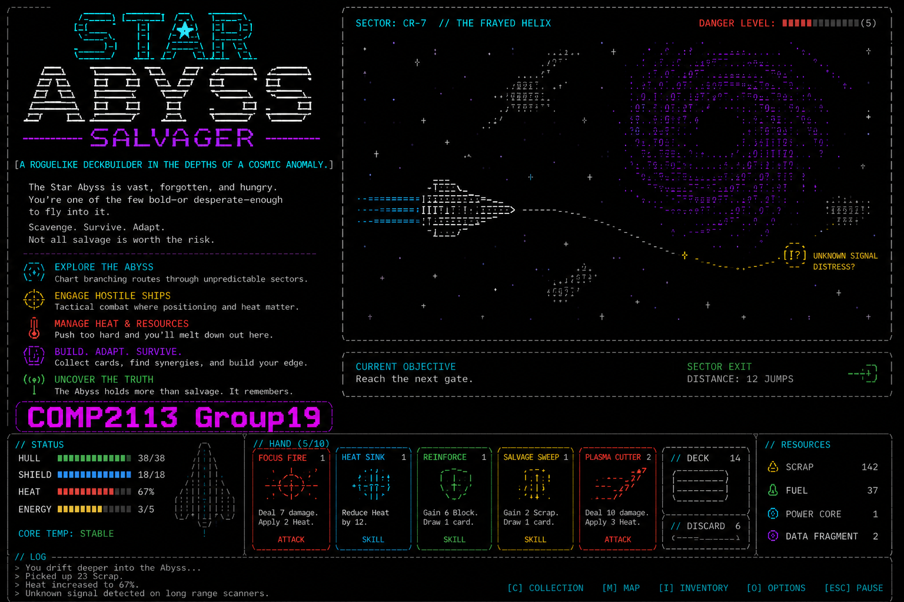
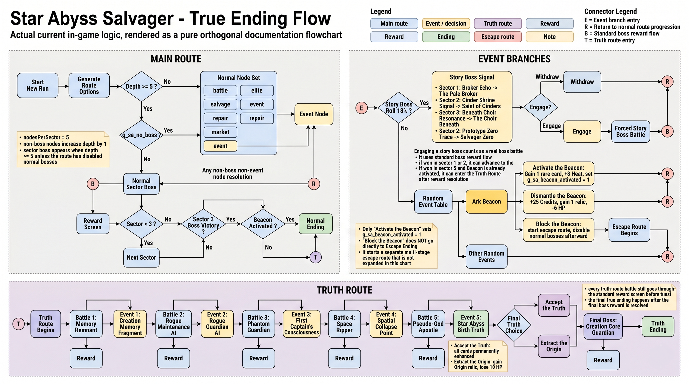
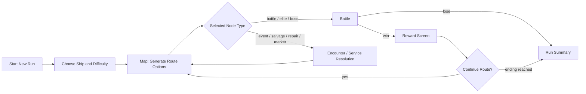
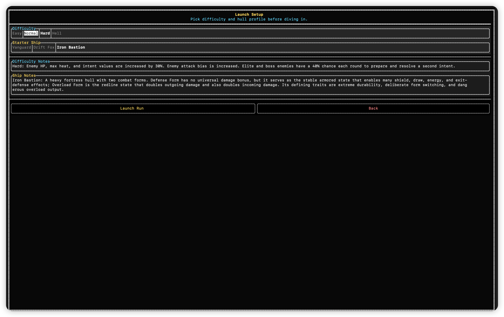
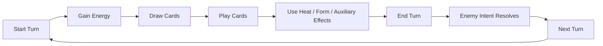
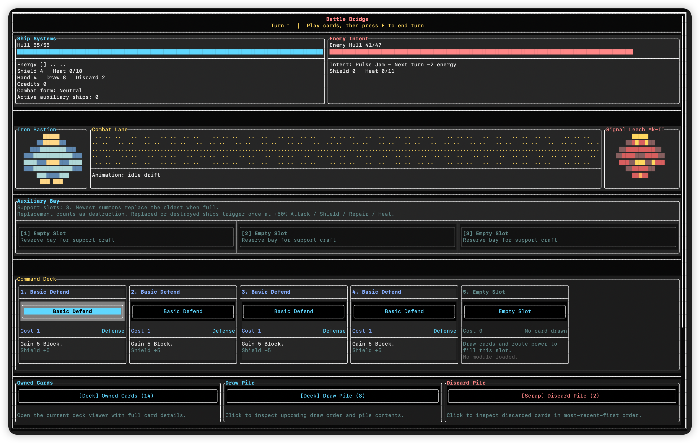
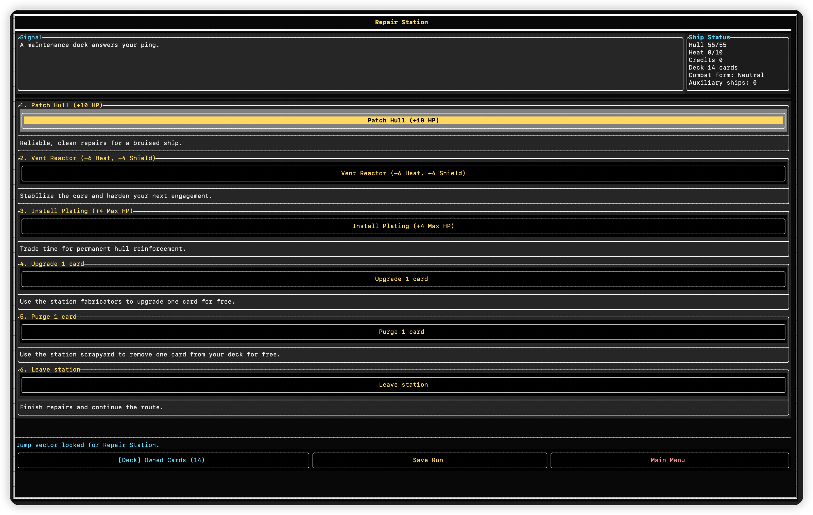
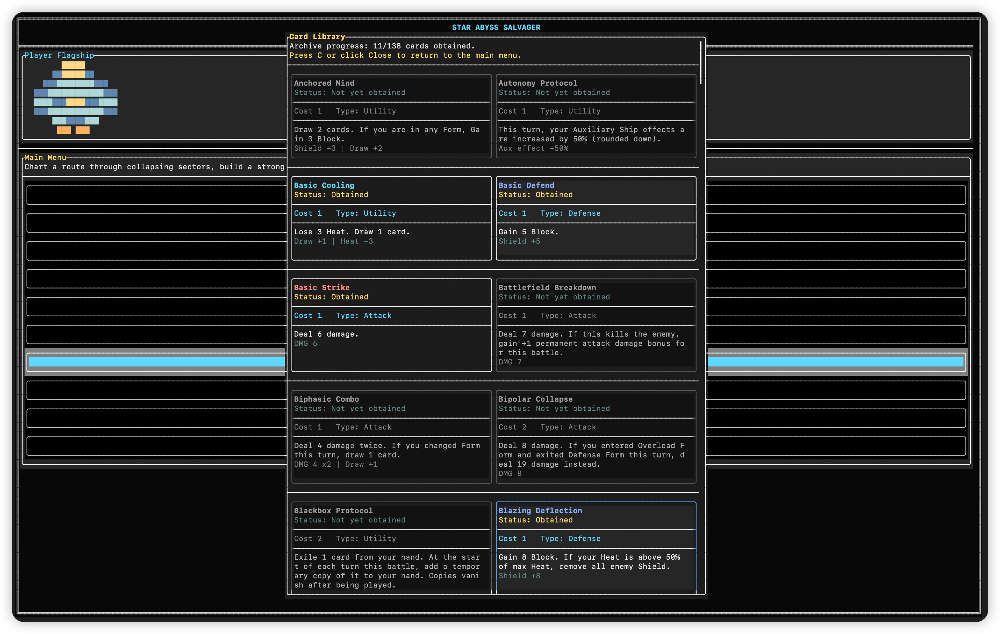
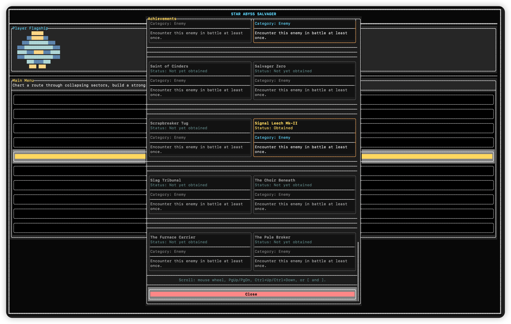

# Star Abyss Salvager

`Star Abyss Salvager` is a terminal roguelike deckbuilding game built for the COMP2113 course project.
You pilot a salvager ship into the Star Abyss, route through unstable sectors, fight hostile ships in turn-based card battles, upgrade or purge cards, collect relics, and push toward one of several endings.

The structure is inspired by **Slay the Spire**, but the implemented game logic is its own system: heat and overheat management, auxiliary ships, form switching, route events, story boss branches, an escape route, and a truth route.

## Screenshot



## Team Members

- `PUFFERFISHTNT` Xu Yukuan (3036478148)
- `Annie-goat` Guo Xinyao (3036483478)
- `victorxsy` Xu Siyuan (3036482955)
- `Andy-MRX` Hu Pengfei (3036588852)
- `Kong Ce` Kong Ce (3036483650)

## Current Content Snapshot

The current repository already contains a fully playable build with:

- `3` playable starter ships
- `4` difficulty levels
- `138` cards loaded from `data/cards.json`
- `20` enemy templates across normal, elite, boss, and story encounters
- sector-based route progression with battles, elites, salvage, repair, event, market, and boss nodes
- branching story logic for:
  - normal ending
  - escape route
  - truth route
- reward screens for cards, relics, and credits
- black market purchase / purge / upgrade services
- repair station heal / vent / plating / upgrade / purge services
- manual save / load and autosave
- card library, owned deck viewer, leaderboard, and achievement tracking
- bilingual English / Chinese UI

## Route and Ending Structure

The route and ending logic below reflects the **actual current in-game implementation**.



### High-level Run Loop



### Current Route Notes

- A normal sector has `5` non-boss depth steps before the sector boss appears.
- The map can generate:
  - `battle`
  - `elite`
  - `salvage`
  - `repair`
  - `event`
  - `market` (from sector 2 onward)
- Event nodes can open:
  - random event branches
  - story boss signals
  - the Ark Beacon branch
  - escape-route progression
  - truth-route progression
- Blocking the Ark Beacon starts the escape route and disables normal boss progression after that point.
- Activating the Ark Beacon is the condition that later allows the truth route to open.

## Playable Ships

### Vanguard

- direct-fire heat offense
- strong burst attacks with deliberate heat buildup
- can trade thermal risk for damage tempo

### Drift Fox

- auxiliary ship / drone-focused playstyle
- uses summon, trigger, destroy, and support interactions
- strongest when the board is filled with the right drone mix

### Auxiliary Ships

- the current battle bay supports up to `3` auxiliary ships
- when the bay is full, newer summons replace the oldest ships
- different drone types can attack, shield, repair, apply enemy heat, or amplify other triggers
- some cards destroy or recycle auxiliary ships for immediate payoff

### Iron Bastion

- form-switching defensive ship
- swaps between `Neutral`, `Overload`, and `Defense`
- can route value through shield, energy, draw, and stance transition effects

## Difficulty Modes



### Easy

- current baseline difficulty with the existing forgiving balance

### Normal

- standard enemy stats
- elite and boss enemies can prepare a second intent with a `30%` chance

### Hard

- enemy HP, max heat, and intent values are increased
- enemy attack bias is stronger
- elite and boss enemies can prepare a second intent with a `40%` chance

### Hell

- enemy scaling matches `Hard`
- enemy attack bias matches `Hard`
- all enemy intents are hidden as `Unknown`
- elite and boss enemies can prepare a second intent with a `50%` chance

## Core Gameplay Systems

### Combat Loop



### Combat Features

- turn-based deck combat
- draw pile, hand, discard pile, and exile pile
- hand limit of `10`
- energy system
- temporary shield system
- heat / overheat stages
- enemy intent forecasting
- elite / boss double-intent pressure on higher difficulties
- form switching
- auxiliary ship deployment, triggering, replacement, and dismantling
- per-card upgrades loaded from `data/cards.json`



### Heat / Overheat

- many cards raise or reduce heat
- if heat exceeds the limit, overflow causes immediate self-damage
- sustained overheat in battle escalates through multiple penalty stages:
  - reduced draw
  - reduced outgoing damage
  - increased incoming damage
  - eventually HP burn each turn
- enemy heat has its own overheat effect too:
  - overheated enemies deal less damage
  - deeper enemy overheat makes them take more damage
  - at the highest stage, enemy overheat also burns enemy HP each turn

### Services and Progression

- black market:
  - buy colorless cards
  - upgrade one card
  - purge one card
- repair station:
  - patch hull
  - vent heat
  - install plating
  - upgrade one card for free
  - purge one card for free
- reward flow:
  - credits
  - card rewards
  - relic rewards on elite / boss victories



## UI and Quality-of-Life

- full-screen FTXUI terminal UI
- keyboard and mouse input
- bilingual English / Chinese interface
- owned-card viewer
- full card library viewer
- achievement viewer
- leaderboard viewer
- scrollable long pages
- autosave and manual named saves





## Compilation

Run all commands from the project root:

```bash
make
```

This builds:

```bash
./star_abyss_salvager
```

### Requirements

- `g++` with C++17 support
- GNU `make`
- a UTF-8 terminal

No internet download is required because FTXUI is vendored in the repository.

## Running the Game

Run from the project root:

```bash
./star_abyss_salvager
```

Please launch the executable from the repository root so these runtime paths resolve correctly:

- `data/cards.json`
- `save/*.sav`
- `save/ui_language.txt`
- `save/obtained_cards.txt`
- `save/completed_events.txt`
- `save/seen_enemies.txt`
- `data/leaderboard.txt`

## Controls

### General

- `1` - `9`, `0`: choose visible menu entries or card/service targets
- `S`: open save dialog
- `L`: open load dialog
- `Esc`: close a modal, leave a service page, go back from info pages, or return to the menu depending on context
- `PgUp` / `PgDn`: scroll long pages
- `Ctrl+Up` / `Ctrl+Down`: alternate scroll
- `[` / `]`: alternate scroll

### Main Menu / Views

- `C`: open the card library from the main menu
- `A`: open achievements from the main menu
- `D`: open the owned deck viewer during a run

### Battle

- `1` - `9`, `0`: play cards in hand
- `E`: end turn
- mouse:
  - click cards
  - click auxiliary ship targets when required
  - click battle utility buttons

### Service Screens

- black market service screens:
  - `Esc`, `B`, or `0`: return to the broker
- repair / event service screens:
  - `Esc` or `0`: leave the service

## Persistent Files

The game reads or writes:

- `data/cards.json`
  - card definitions and upgrade definitions
- `save/*.sav`
  - manual saves and autosave
- `save/ui_language.txt`
  - current language preference
- `save/obtained_cards.txt`
  - unlocked card registry
- `save/completed_events.txt`
  - event achievement registry
- `save/seen_enemies.txt`
  - enemy discovery registry
- `data/leaderboard.txt`
  - recorded run results


## Non-Standard Library

### FTXUI

This repository vendors [FTXUI](https://github.com/ArthurSonzogni/FTXUI) under `vendor/FTXUI/`.

FTXUI is used for:

- full-screen terminal rendering
- buttons, toggles, menus, and modal dialogs
- keyboard and mouse input
- page layout and panels
- scrollable UI pages

## Project Structure

```text
.
|-- Makefile
|-- README.md
|-- data/
|   |-- cards.json
|   `-- leaderboard.txt
|-- docs/
|   `-- images/
|       `-- true-ending-flow.png
|-- include/
|   |-- engine/
|   |-- ui/
|   |-- tui_app.h
|   `-- tui_game.h
|-- save/
|-- src/
|   |-- engine/
|   |-- ui/
|   |-- tui_app.cpp
|   |-- tui_game.cpp
|   `-- tui_main.cpp
`-- vendor/
    `-- FTXUI/
```
